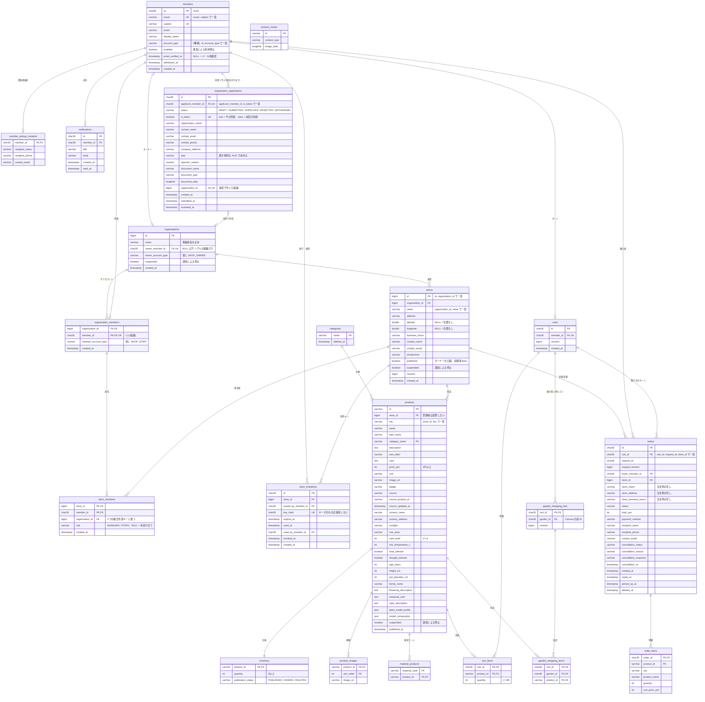

# EC のデータベース構成（ER 図）

2026-11-11 決定。店舗側アカウントの作り直し（#103）で作る、新しい DB の構成です。決定の経緯は [decisions/2026-11-11-shop-organization-db-v3.md](decisions/2026-11-11-shop-organization-db-v3.md) にあります。

- この構成は、統合ブランチ `feature/shop-organization` で作るものです。main の DB（Flyway の V1〜V15）とは違います
- マイグレーションはまだありません。#107 で、[database-v3-check/schema.sql](database-v3-check/schema.sql) のテーブル定義から作ります
- 既存のデータは移行しません。DB は初期化スクリプト（#106）で作り直します
- 列の型・長さ・初期値・制約名は、`schema.sql` を正とします。この図と `schema.sql` が食い違ったら、`schema.sql` に合わせて図を直します

## 1. ER 図

テーブルは21個です。`product_media`（画像の本体）は、ほかのテーブルから外部キーで参照されません。`product_images.image_url` と `products.image_url` の URL から読み出します。

## 2. 会員の種別

`members.account_type` は次の5種類で、CHECK 制約が完全一致だけを許します（小文字や前後の空白は拒否されます）。

| 値 | 意味 | できること |
| --- | --- | --- |
| `USER` | 購入者 | 購入、Canvas |
| `SHOP_OWNER_APPLICANT` | 申請中の法人用アカウント | 会社情報の登録、申請、取り下げ、再申請だけ |
| `SHOP_OWNER` | 組織のオーナー | 自分の組織の全店舗と子アカウント |
| `SHOP_STAFF` | 子アカウント | 割り当てられた店舗を、店舗ごとのロールで |
| `ADMIN` | 運営 | 全組織・全店舗の閲覧と停止 |

`SHOP_` は「店舗」ではなく「店舗側のアカウント」を表す接頭辞です（#102）。

## 3. DB が拒否すること

してはいけない組み合わせは、アプリケーションの確認に加えて、DB の制約でも拒否します。トリガーは使いません。

| 制約 | DB が拒否すること |
| --- | --- |
| `organizations(owner_member_id, owner_account_type)` → `members(id, account_type)`、`owner_account_type = 'SHOP_OWNER'` の CHECK | 購入者・申請中・子アカウント・運営をオーナーにする。オーナーである間の種別の変更 |
| `organizations.owner_member_id` の一意キー | 1人が2つの組織のオーナーになる |
| `organization_members(member_id, member_account_type)` → `members(id, account_type)`、`member_account_type = 'SHOP_STAFF'` の CHECK | 子アカウント以外を組織に所属させる。所属している間の種別の変更 |
| `organization_members.member_id` の一意キー | 1人が2つの組織に所属する |
| `store_members(store_id, organization_id)` → `stores(id, organization_id)` | 別の組織の店舗に担当を割り当てる |
| `store_members(organization_id, member_id)` → `organization_members(organization_id, member_id)`（`ON DELETE CASCADE`） | 所属していない人・オーナーを店舗の担当にする。組織から外すと、担当も消える |
| `store_members.role` の CHECK | `MANAGER`・`STAFF` 以外のロール（NULL は「未割り当て」として許す） |
| `organization_applications(applicant_member_id, is_latest)` の一意キー | 同じ人の「今の申請」の2行目、「前回の申請」の2行目（1人につき、今の申請と前回の申請の2行まで） |
| `is_latest OR status IN ('REJECTED', 'WITHDRAWN')` の CHECK | 下書き・審査中・承認済みの申請を「前回の申請」にする |
| `(status = 'APPROVED') = (organization_id IS NOT NULL)` の CHECK | 組織のない承認済みの申請。承認済みでない申請に組織を付ける |
| `stores(organization_id, name)` の一意キー | 同じ組織に同じ名前の店舗 |
| `(latitude IS NULL) = (longitude IS NULL)` の CHECK | 緯度と経度の片方だけの入力 |
| `store_invitations.key_hash` の一意キー、`(used_at IS NULL) = (used_by_member_id IS NULL)` の CHECK | 同じ招待キー。使用日時と使用者の片方だけの入力 |
| `products.store_id` が必須で `stores(id)` を参照 | 店舗のない商品、存在しない店舗の商品 |
| `products(store_id, sku)` の一意キー | 同じ店舗に同じ商品番号（店舗が違えば使える） |
| `inventory` の主キーが `product_id`、`quantity >= 0` の CHECK | 1つの商品に在庫を2行持つ。在庫を超える減算 |
| `carts.member_id` の一意キー、`cart_items.quantity` が1〜99の CHECK | 1人に2つ目のカート。数量0や100以上 |
| `orders(cart_id, request_id, store_id)` の一意キー | 同じ購入の操作から、同じ店舗への2件目の注文 |
| `orders.store_id` → `stores(id)` | 注文のある店舗の削除 |

`owner_account_type` と `member_account_type` は、有効・無効を表す列ではありません。複合外部キーを成り立たせるための固定値の列で、値は `members.account_type` の値と同じでなければなりません。

## 4. 公開と停止の列

「オーナー・出店者が自分で行う公開／非公開」と「運営による停止」を、別の列で持ちます。

| 列 | 誰が変えるか | 意味 |
| --- | --- | --- |
| `stores.published` | オーナー | 初期値は false。必須の項目を入れて公開の操作をすると true |
| `stores.suspended` | 運営 | 店舗単位の停止 |
| `organizations.suspended` | 運営 | 組織単位の停止 |
| `inventory.publication_status` | 出店者 | 商品の公開（`PUBLISHED`）・非公開（`HIDDEN`）・削除（`DELETED`） |
| `products.suspended` | 運営 | 商品単位の停止 |

商品が購入者に見える条件は、次のすべてです。

- 組織が停止されていない（`organizations.suspended = false`）
- 店舗が公開されていて、停止されていない（`stores.published = true` かつ `stores.suspended = false`）
- 商品が停止されていない（`products.suspended = false`）
- 商品が公開されている（`inventory.publication_status = 'PUBLISHED'`）

`members.enabled` は、運営による会員の利用停止です。公開の条件には入りません。

## 5. 今のテーブル（V1〜V15）との対応

名前が変わるもの、なくなるもの、足されるものの一覧です。ここにないテーブルと列は、今の名前のままです。

### テーブル

| 今 | 新しい構成 | 理由 |
| --- | --- | --- |
| `auth_members` | `members` | 互換性が不要になり、名前を残す理由がなくなったため |
| `store_applications` | `organization_applications` | 申請の対象が店舗ではなく組織になったため |
| `cart_details`、`member_addresses`、`order_details` | なくす | 店舗受け取りだけにするため。受取連絡先と支払方法は `orders` に入れる |
| なし | `organizations`、`organization_members`、`store_members`、`store_invitations` | 組織・所属・店舗の担当・招待キー |

### 列

| テーブル | 今 | 新しい構成 |
| --- | --- | --- |
| `members` | `role`（`USER` / `SELLER` / `ADMIN`） | `account_type`（5種類） |
| `members` | `store_id` | なくす（店舗とのつながりは `organizations`・`store_members` で持つ） |
| `members` | なし | `email_verified_at`、`created_at` |
| `organization_applications` | `member_id`、`company`、`contact`、`email`、`phone`、`address`、`reason` | `applicant_member_id`、`organization_name`、`contact_name`、`contact_email`、`contact_phone`、`company_address`、`rejection_reason` |
| `organization_applications` | 審査中の状態の名前は `PENDING` | `SUBMITTED` |
| `organization_applications` | 再申請のたびに行が増える | 1人につき「今の申請」と「前回の申請」の2行まで（`is_latest`）。再申請で新しい行を作り、前々回の行は消す |
| `organization_applications` | なし | `organization_id`、`submitted_at`。状態に `DRAFT`・`WITHDRAWN` を足す。書類の3列と却下の理由は、空にできる（下書きには書類がないため） |
| `stores` | `hours`、`contact`、`email`、`story` | `business_hours`、`contact_name`、`contact_email`、`introduction` |
| `stores` | `company` | なくす（事業者名は `organizations.name` だけに持つ） |
| `stores` | `enabled` | `published`（オーナー）と `suspended`（運営）に分ける |
| `stores` | 緯度経度は必須 | 空にできる（位置なし） |
| `stores` | なし | `organization_id`、`created_at` |
| `products` | `category` | `category_name` |
| `products` | `owner_member_id`、`active` | なくす。持ち主は `store_id`、公開状態は `inventory.publication_status` と `products.suspended` |
| `products` | `sku` が全体で一意 | `(store_id, sku)` で一意 |
| `products` | なし | `store_id`（必須） |
| `inventory` | 主キー `(store_id, product_id)` | 主キー `product_id`。`store_id` はなくす |
| `inventory` | `publication_status` の初期値 `PUBLISHED` | 初期値 `HIDDEN` |
| `carts` | `store_id` | なくす |
| `carts` | `member_id` は空にできる | 必須（未ログインではカートを使えない。#10） |
| `cart_items` | `store_id` | なくす（受取店舗は商品の店舗） |
| `orders` | `pickup_address`、`pickup_hours` | `store_address`、`store_business_hours` |
| `orders` | `subtotal_yen`、`shipping_fee_yen` | なくす（送料がないため、金額は `total_yen` だけ） |
| `orders` | `buyer_member_id`、`store_id` は空にできる | 必須 |
| `orders` | なし | `payment_method`、`recipient_name`、`recipient_phone`、`contact_email`（`order_details` から移す） |

文字列の長さは、今より短くしていません（同じか、長くしています）。

## 6. Canvas の DB とのつながり

EC と Canvas は別の DB なので、外部キーは張れません。つながりは次の3つの値だけです。

| EC の値 | Canvas の値 |
| --- | --- |
| `members.id` | 庭の持ち主（abeouga/kusakari-canvas#63 で `gardens.owner_member_id` にする） |
| `products.id` | 配置した商品（`placed_objects.product_id`） |
| `garden_shopping_lists.garden_id` | 庭の ID（`gardens.id`） |

## 7. この構成に入れていないもの

決まったら、この図と `schema.sql` を直します。

| 項目 | 今の仮の形 | 決める場所 |
| --- | --- | --- |
| 招待キーは1回限りか、期限内なら何人でも使えるか | 1回限り（`used_at`、`used_by_member_id`） | #105 |
| 料金プランを組織と店舗のどちらに持つか | 申請の行に `plan` を残す | #125 |
| 同じ品種の商品をジャンルでまとめて表示するか | 入れていない | issue はまだない |
| `material_products` を残すか | 残している | #119 |
| 店舗の閉鎖の状態 | 入れていない | #79 |
| 運営の警告の記録 | 入れていない | #16 |
| 発送（自宅配送）の列 | 入れていない | #120 |
