# EC のデータベース構成（ER 図）

2026-11-11 決定、2026-11-12 更新。店舗側アカウントの作り直し（#103）で作る、新しい DB の構成です。決定の経緯は次の2つにあります。

- [decisions/2026-11-11-shop-organization-db-v3.md](decisions/2026-11-11-shop-organization-db-v3.md)：構成（v3）の採用
- [decisions/2026-11-12-db-v3-payments-closure-roles.md](decisions/2026-11-12-db-v3-payments-closure-roles.md)：決済と返金、手数料、店舗の閉鎖、組織のロール、招待キー、警告の履歴の追加

この文書の前提は次のとおりです。

- この構成は、統合ブランチ `feature/shop-organization` で作るものです。main の DB（Flyway の V1〜V15）とは違います
- マイグレーションはまだありません。#107 で、[database-v3-check/schema.sql](database-v3-check/schema.sql) のテーブル定義から作ります
- 既存のデータは移行しません。DB は初期化スクリプト（#106）で作り直します
- 列の型・長さ・初期値・制約名は、`schema.sql` を正とします。この図と `schema.sql` が食い違ったら、`schema.sql` に合わせて図を直します
- 決済は Stripe のテストモードだけを使います。実際のお金は動かしません

## 1. ER 図

```mermaid
erDiagram
    members {
        char36 id PK "UUID"
        varchar issuer UK "issuer, subject で一意"
        varchar subject UK
        varchar email
        varchar display_name
        varchar account_type "5種類。id, account_type で一意"
        boolean enabled "運営による利用停止"
        timestamp email_verified_at "NULL = メール未確認"
        timestamp withdrawn_at
        timestamp created_at
    }
    member_pickup_contacts {
        char36 member_id PK, FK
        varchar recipient_name
        varchar recipient_phone
        varchar contact_email
    }
    notifications {
        char36 id PK
        char36 member_id FK
        varchar title
        varchar body
        timestamp created_at
        timestamp read_at
    }
    organization_applications {
        char36 id PK
        char36 applicant_member_id FK, UK "applicant_member_id, is_latest で一意"
        varchar status "DRAFT / SUBMITTED / APPROVED / REJECTED / WITHDRAWN"
        boolean is_latest UK "true = 今の申請、false = 前回の申請"
        varchar organization_name
        varchar contact_name
        varchar contact_email
        varchar contact_phone
        varchar company_address
        varchar rejection_reason
        varchar document_name
        varchar document_type
        longblob document_data
        bigint organization_id FK, UK "承認で作った組織"
        timestamp created_at
        timestamp submitted_at
        timestamp reviewed_at
    }
    organizations {
        bigint id PK
        varchar name "事業者名の正本"
        char36 owner_member_id FK, UK "NULL はサンプルの組織だけ"
        varchar owner_account_type "常に SHOP_OWNER"
        timestamp suspension_started_at "NULL = 通常。日時あり = 受付停止中"
        boolean suspended "運営による停止"
        timestamp created_at
    }
    organization_members {
        bigint organization_id PK, FK
        char36 member_id PK, FK, UK "1人1組織"
        varchar member_account_type "常に SHOP_STAFF"
        varchar role "ORG_ADMIN。NULL = ロールなし"
        timestamp created_at
    }
    stores {
        bigint id PK "id, organization_id で一意"
        bigint organization_id FK
        varchar name "organization_id, name で一意"
        varchar address
        double latitude "NULL = 位置なし"
        double longitude "NULL = 位置なし"
        varchar business_hours
        varchar contact_name
        varchar contact_email
        varchar introduction
        boolean published "オーナーの公開。初期値 false"
        boolean suspended "運営による停止"
        timestamp closing_started_at "NULL = 営業中。日時あり = 閉鎖中"
        varchar closing_started_by "OWNER / ADMIN"
        timestamp closed_at "日時あり = 閉鎖済み"
        bigint revision
        timestamp created_at
    }
    store_members {
        bigint store_id PK, FK
        char36 member_id PK, FK
        bigint organization_id FK "2つの複合外部キーに使う"
        varchar role "MANAGER / STAFF。NULL = 未割り当て"
        timestamp created_at
    }
    store_invitations {
        char36 id PK
        bigint store_id FK
        char36 issued_by_member_id FK
        char64 key_hash UK "キーそのものは保存しない"
        timestamp expires_at "発行から30日"
        int max_uses "1 = 1回限り。NULL = 期限内なら何回でも"
        timestamp revoked_at
        timestamp created_at
    }
    store_invitation_uses {
        char36 invitation_id PK, FK
        char36 member_id PK, FK, UK "1人1行"
        timestamp used_at
    }
    categories {
        varchar name PK
        timestamp deleted_at
    }
    products {
        varchar id PK
        bigint store_id FK "登録後は変更しない"
        varchar sku "store_id, sku で一意"
        varchar name
        varchar latin_name
        varchar category_name FK
        text description
        varchar size_label
        text care
        int price_yen "1円以上"
        varchar unit
        varchar image_url
        varchar badge
        varchar source
        varchar source_product_id
        timestamp source_updated_at
        varchar nursery_name
        varchar nursery_address
        varchar sunlight
        varchar use_case
        int care_level "1〜3"
        int min_temperature_c
        boolean heat_tolerant
        boolean drought_tolerant
        int age_years
        int height_cm
        int pot_diameter_cm
        varchar family_name
        text flowering_description
        text seasonal_care
        text style_description
        json plant_model_profile
        json model_composition
        boolean suspended "運営による停止"
        timestamp published_at
    }
    inventory {
        varchar product_id PK, FK
        int quantity "0以上"
        varchar publication_status "PUBLISHED / HIDDEN / DELETED"
    }
    product_images {
        varchar product_id PK, FK
        int sort_order PK
        varchar image_url
    }
    product_media {
        varchar id PK
        varchar content_type
        longblob image_data
    }
    material_products {
        varchar material_code PK
        varchar product_id PK, FK
    }
    carts {
        char36 id PK
        char36 member_id FK, UK
        bigint revision
        timestamp created_at
    }
    cart_items {
        char36 cart_id PK, FK
        varchar product_id PK, FK
        int quantity "1〜99"
    }
    garden_shopping_lists {
        char36 cart_id PK, FK
        char36 garden_id PK "Canvas の庭 ID"
        bigint revision
    }
    garden_shopping_items {
        char36 cart_id PK, FK
        char36 garden_id PK, FK
        varchar product_id PK, FK
    }
    payments {
        char36 id PK
        char36 cart_id FK, UK "cart_id, request_id で一意（お会計1回に1つ）"
        char36 request_id UK
        char36 buyer_member_id FK
        varchar payment_intent_id UK "Stripe の PaymentIntent"
        varchar status "PENDING / SUCCEEDED / FAILED / EXPIRED（仮）"
        int amount_yen "お会計の合計。1円以上"
        timestamp created_at
        timestamp updated_at
    }
    stripe_events {
        varchar event_id PK "処理済みの通知。2回処理しない"
        varchar event_type
        timestamp processed_at
    }
    orders {
        char36 id PK
        char36 cart_id FK "cart_id, request_id, store_id で一意"
        char36 request_id
        bigint request_revision
        char36 payment_id FK "同じお会計の決済だけを指せる"
        char36 buyer_member_id FK
        bigint store_id FK
        varchar store_name "注文時の写し"
        varchar store_address "注文時の写し"
        varchar store_business_hours "注文時の写し"
        varchar status "PENDING_PAYMENT / ACCEPTED / READY / COMPLETED / CANCELLED"
        int total_yen
        int commission_rate_bp "注文時の手数料の率。800 = 8%"
        int commission_yen "注文時の手数料の額"
        varchar payment_method
        varchar recipient_name
        varchar recipient_phone
        varchar contact_email
        varchar cancellation_status "NONE / PENDING / APPROVED / REJECTED"
        varchar cancellation_reason
        varchar cancellation_response
        timestamp cancellation_at
        char36 cancelled_by_member_id FK "キャンセルした人"
        timestamp created_at
        timestamp ready_at
        timestamp picked_up_at
        timestamp deleted_at
    }
    order_items {
        char36 order_id PK, FK
        varchar product_id PK
        varchar sku
        varchar product_name
        int quantity
        int unit_price_yen
    }
    refunds {
        char36 id PK
        char36 order_id FK, UK "注文1件につき1行"
        char36 payment_id FK "その注文が支払われた決済"
        varchar stripe_refund_id UK "Stripe の Refund"
        varchar status "REQUESTED / SUCCEEDED / FAILED（仮）"
        int amount_yen "注文の合計。1円以上"
        char36 requested_by_member_id FK "NULL = Stripe の管理画面から"
        timestamp created_at
        timestamp updated_at
    }
    product_moderation_events {
        bigint id PK
        varchar product_id FK
        varchar event_type "WARN / CLEAR_WARNING / SUSPEND / RESUME"
        varchar reason "警告と停止では必須"
        char36 actor_member_id FK "操作した運営者"
        timestamp created_at
    }
    store_moderation_events {
        bigint id PK
        bigint store_id FK
        varchar event_type "WARN / CLEAR_WARNING / SUSPEND / RESUME"
        varchar reason "警告と停止では必須"
        char36 actor_member_id FK "操作した運営者"
        timestamp created_at
    }

    members ||--o| member_pickup_contacts : "受取連絡先"
    members ||--o{ notifications : "宛先"
    members ||--o{ organization_applications : "申請（今と前回の2行まで）"
    organization_applications |o--o| organizations : "承認で作成"
    members |o--o| organizations : "オーナー"
    members ||--o| organization_members : "所属"
    organizations ||--o{ organization_members : "子アカウント"
    organizations ||--o{ stores : "運営"
    stores ||--o{ store_members : "担当者"
    organization_members ||--o{ store_members : "担当"
    stores ||--o{ store_invitations : "招待キー"
    members ||--o{ store_invitations : "発行"
    store_invitations ||--o{ store_invitation_uses : "使った人"
    members ||--o| store_invitation_uses : "登録に使ったキー"
    stores ||--o{ products : "商品"
    categories ||--o{ products : "分類"
    products ||--|| inventory : "在庫"
    products ||--o{ product_images : "画像"
    products ||--o{ material_products : "素材コード"
    members ||--o| carts : "カート"
    carts ||--o{ cart_items : "明細"
    products ||--o{ cart_items : "商品"
    carts ||--o{ garden_shopping_lists : "庭の買い物リスト"
    garden_shopping_lists ||--o{ garden_shopping_items : "商品"
    products ||--o{ garden_shopping_items : "商品"
    carts ||--o{ payments : "お会計"
    members ||--o{ payments : "支払う人"
    payments |o--o{ orders : "店舗ごとの注文"
    carts ||--o{ orders : "購入元のカート"
    members ||--o{ orders : "購入者"
    members |o--o{ orders : "キャンセルした人"
    stores ||--o{ orders : "受取店舗"
    orders ||--|{ order_items : "明細"
    orders ||--o| refunds : "返金"
    payments ||--o{ refunds : "返金元の決済"
    members |o--o{ refunds : "返金を始めた人"
    products ||--o{ product_moderation_events : "警告・停止の履歴"
    stores ||--o{ store_moderation_events : "警告・停止の履歴"
    members ||--o{ product_moderation_events : "操作した運営者"
    members ||--o{ store_moderation_events : "操作した運営者"
```

テーブルは27個です。`product_media`（画像の本体）と `stripe_events`（処理済みの通知）は、ほかのテーブルから外部キーで参照されません。

テーブルのほかに、閉鎖済みになってから90日たった店舗の連絡先を消すイベント（`ev_stores_clear_closed_contacts`、1日1回）があります。

## 2. 会員の種別と、2つのロール

`members.account_type` は次の5種類で、CHECK 制約が完全一致だけを許します（小文字や前後の空白は拒否されます）。

| 値 | 意味 | できること |
| --- | --- | --- |
| `USER` | 購入者 | 購入、Canvas |
| `SHOP_OWNER_APPLICANT` | 申請中の法人用アカウント | 会社情報の登録、申請、取り下げ、再申請だけ |
| `SHOP_OWNER` | 組織のオーナー | 自分の組織の全店舗と子アカウント |
| `SHOP_STAFF` | 子アカウント | 割り当てられた店舗を、店舗ごとのロールで |
| `ADMIN` | 運営 | 全組織・全店舗の閲覧と停止 |

`SHOP_` は「店舗」ではなく「店舗側のアカウント」を表す接頭辞です（#102）。

子アカウントのロールは2種類あり、受け持つ操作が重なりません（#105）。

| ロール | 持つ場所 | 値 | 受け持つ操作 |
| --- | --- | --- | --- |
| 店舗のロール | 店舗の担当（`store_members.role`） | `MANAGER` / `STAFF` / 空（未割り当て） | 商品・在庫・注文など、その店舗の操作 |
| 組織のロール | 組織への所属（`organization_members.role`） | `ORG_ADMIN`（仮名）/ 空（ロールなし） | 組織の全員のアカウント一覧、`MANAGER` の付与、別の店舗の担当の追加・解除（人事の操作） |

`ORG_ADMIN` でも、商品・在庫・注文の操作は、担当している店舗のロールに従います。

## 3. DB が拒否すること

してはいけない組み合わせは、アプリケーションの確認に加えて、DB の制約でも拒否します。トリガーは使いません。

### 組織・店舗・担当

| 制約 | DB が拒否すること |
| --- | --- |
| `organizations(owner_member_id, owner_account_type)` → `members(id, account_type)`、`owner_account_type = 'SHOP_OWNER'` の CHECK | 購入者・申請中・子アカウント・運営をオーナーにする。オーナーである間の種別の変更 |
| `organizations.owner_member_id` の一意キー | 1人が2つの組織のオーナーになる |
| `suspended = FALSE OR suspension_started_at IS NOT NULL` の CHECK | 受付停止を経ずに組織を停止する |
| `organization_members(member_id, member_account_type)` → `members(id, account_type)`、`member_account_type = 'SHOP_STAFF'` の CHECK | 子アカウント以外を組織に所属させる。所属している間の種別の変更 |
| `organization_members.member_id` の一意キー | 1人が2つの組織に所属する |
| `organization_members.role` の CHECK | `ORG_ADMIN` 以外の組織のロール（NULL は「ロールなし」として許す） |
| `store_members(store_id, organization_id)` → `stores(id, organization_id)` | 別の組織の店舗に担当を割り当てる |
| `store_members(organization_id, member_id)` → `organization_members(organization_id, member_id)`（`ON DELETE CASCADE`） | 所属していない人・オーナーを店舗の担当にする。組織から外すと、担当も消える |
| `store_members.role` の CHECK | `MANAGER`・`STAFF` 以外のロール（NULL は「未割り当て」として許す。`ORG_ADMIN` は付けられない） |
| `stores(organization_id, name)` の一意キー | 同じ組織に同じ名前の店舗 |
| `(latitude IS NULL) = (longitude IS NULL)` の CHECK | 緯度と経度の片方だけの入力 |
| `(closing_started_at IS NULL) = (closing_started_by IS NULL)`、`closing_started_by` が `OWNER`・`ADMIN` の CHECK | 誰が始めたか分からない閉鎖。オーナー・運営以外が始めた閉鎖 |
| `closed_at IS NULL OR closing_started_at IS NOT NULL` の CHECK | 閉鎖中を経ない閉鎖済み |

### 出店申請と招待キー

| 制約 | DB が拒否すること |
| --- | --- |
| `organization_applications(applicant_member_id, is_latest)` の一意キー | 同じ人の「今の申請」の2行目、「前回の申請」の2行目（1人につき、今の申請と前回の申請の2行まで） |
| `is_latest OR status IN ('REJECTED', 'WITHDRAWN')` の CHECK | 下書き・審査中・承認済みの申請を「前回の申請」にする |
| `(status = 'APPROVED') = (organization_id IS NOT NULL)` の CHECK | 組織のない承認済みの申請。承認済みでない申請に組織を付ける |
| `store_invitations.key_hash` の一意キー、`max_uses` が空か1以上の CHECK | 同じ招待キー。上限回数0 |
| `store_invitation_uses` の主キー `(invitation_id, member_id)`、`member_id` の一意キー | 同じ人が同じキーを2回使った記録。キーで登録した人が別のキーを使った記録 |

招待キーの上限回数を超えないことは、DB の制約では守れません。キーの行をロックしてから使用記録の件数を確かめる処理を、アプリケーションが行います（#111）。

### 商品・カート・注文

| 制約 | DB が拒否すること |
| --- | --- |
| `products.store_id` が必須で `stores(id)` を参照 | 店舗のない商品、存在しない店舗の商品 |
| `products(store_id, sku)` の一意キー | 同じ店舗に同じ商品番号（店舗が違えば使える） |
| `inventory` の主キーが `product_id`、`quantity >= 0` の CHECK | 1つの商品に在庫を2行持つ。在庫を超える減算 |
| `carts.member_id` の一意キー、`cart_items.quantity` が1〜99の CHECK | 1人に2つ目のカート。数量0や100以上 |
| `orders(cart_id, request_id, store_id)` の一意キー | 同じ購入の操作から、同じ店舗への2件目の注文 |
| `orders.store_id` → `stores(id)` | 注文のある店舗の削除 |
| `orders.status`・`orders.cancellation_status` の CHECK | 知らない注文の状態、知らないキャンセル申請の状態 |
| `commission_rate_bp` が0〜10000、`commission_yen` が0以上で合計以下の CHECK | 100%を超える手数料の率。合計金額を超える手数料 |
| `orders.cancelled_by_member_id` → `members(id)` | 存在しない会員をキャンセルした人にする |

### 決済・返金・警告の履歴

| 制約 | DB が拒否すること |
| --- | --- |
| `payments(cart_id, request_id)` の一意キー | 同じお会計に決済を2つ作る（二重の請求） |
| `payments.payment_intent_id` の一意キー | 同じ PaymentIntent を2つの決済に付ける |
| `orders(payment_id, cart_id, request_id)` → `payments(id, cart_id, request_id)` | 注文が、別のお会計の決済を指す |
| `stripe_events` の主キー `event_id` | 同じ通知を2回処理する（在庫・通知・返金の二重処理） |
| `refunds.order_id` の一意キー | 同じ注文への2つ目の返金（二重の返金） |
| `refunds(order_id, payment_id)` → `orders(id, payment_id)` | 注文が支払われた決済と違う決済からの返金 |
| `payments.amount_yen`・`refunds.amount_yen` が1以上、状態の CHECK | 0円の決済・返金。知らない状態 |
| `product_moderation_events`・`store_moderation_events` の種別の CHECK、理由の CHECK、対象への外部キー | 知らない操作の種別。理由のない警告・停止。存在しない商品・店舗への履歴 |

`owner_account_type` と `member_account_type` は、有効・無効を表す列ではありません。複合外部キーを成り立たせるための固定値の列で、値は `members.account_type` の値と同じでなければなりません。

## 4. 公開・停止・閉鎖の列

「オーナー・出店者が自分で行う公開／非公開」「運営による停止」「閉鎖」を、別の列で持ちます。

| 列 | 誰が変えるか | 意味 | 元に戻せるか |
| --- | --- | --- | --- |
| `stores.published` | オーナー | 初期値は false。必須の項目を入れて公開の操作をすると true | 戻せる |
| `stores.suspended` | 運営 | 店舗単位の停止 | 戻せる |
| `stores.closing_started_at`、`closing_started_by` | オーナー・運営 | 閉鎖中。新規注文の受付を止める | 閉鎖中の間は戻せる（運営が始めた閉鎖は運営だけ） |
| `stores.closed_at` | 自動（未完了の注文がなくなった時点） | 閉鎖済み | 戻せない |
| `organizations.suspension_started_at` | 運営 | 受付停止中。配下のすべての店舗の新規注文の受付を止める | 戻せる |
| `organizations.suspended` | 自動（未完了の注文がなくなった時点） | 組織単位の停止 | 戻せる（再開） |
| `inventory.publication_status` | 出店者 | 商品の公開（`PUBLISHED`）・非公開（`HIDDEN`）・削除（`DELETED`） | 戻せる（削除を除く） |
| `products.suspended` | 運営 | 商品単位の停止 | 戻せる |

商品が購入者に見え、注文を受け付けられる条件は、次のすべてです。この判定は1か所の処理にまとめます（#109）。

- 組織が受付停止中・停止でない（`organizations.suspension_started_at` が空）
- 店舗が公開されていて、停止されておらず、閉鎖中・閉鎖済みでない（`stores.published = true`、`stores.suspended = false`、`stores.closing_started_at` が空）
- 商品が停止されていない（`products.suspended = false`）
- 商品が公開されている（`inventory.publication_status = 'PUBLISHED'`）

そのほかの決まりは次のとおりです。

- `members.enabled` は、運営による会員の利用停止です。公開の条件には入りません
- 「今、警告中か」は列で持たず、警告の履歴のうち最新の `WARN` と最新の `CLEAR_WARNING` を比べて求めます（#16）
- 閉鎖・停止しても、店舗・商品・在庫の行は消しません。閉鎖済みになってから90日後に、店舗の連絡先（担当者名・連絡用メール）だけをイベントで消します（#79）
- 閉鎖済みになった店舗は、担当（`store_members`）の行を消します。組織への所属は残します（#79）

## 5. 注文・決済・返金の流れ

決済は Stripe のテストモードだけを使います（#131〜#133）。状態の名前と細かいルールは、#131 の「決めること」が決まるまで仮です。

| 場面 | DB で起きること |
| --- | --- |
| お会計 | 決済を1つ作り（`payments`、状態 `PENDING`）、受取店舗ごとに注文を作る（`orders`、状態 `PENDING_PAYMENT`）。在庫をこの時点で減らす。注文に、そのときの手数料の率と額を保存する |
| 支払い成功の通知 | 通知を `stripe_events` に記録し、決済を `SUCCEEDED`、注文を `ACCEPTED` にする。同じ通知の2回目は、主キーの重複で止まる |
| 支払い失敗・時間切れ | 決済を `FAILED`・`EXPIRED`、注文を `CANCELLED` にして、在庫を戻す |
| 受け取りの準備・受け渡し | 注文を `READY`、`COMPLETED` にする |
| キャンセルの承認、運営のまとめてのキャンセル | 注文を `CANCELLED` にし、キャンセルした人を記録し、返金を1行作り（`refunds`、状態 `REQUESTED`、金額はその注文の合計）、在庫を戻す |
| 返金の通知 | 通知を `stripe_events` に記録し、返金を `SUCCEEDED` か `FAILED` にする |

- お会計1回に決済は1つで、店舗ごとの注文は同じ決済を指します。1つの注文をキャンセルすると、その注文の金額だけを返金します（一部返金）
- 「返金済み」「一部返金済み」は列で持ちません。注文ごとの返金の行から求めます
- 手数料は、注文の合計金額 × 率（8%）で、1円未満は切り捨てます。表示するだけで、請求・精算はしません（#130）
- 購入者のキャンセル申請の状態（`cancellation_status`）と、誰がキャンセルしたか（`cancelled_by_member_id`）は別の列です。運営がまとめてキャンセルしても、申請の状態は変わりません（#79）

## 6. 今のテーブル（V1〜V15）との対応

名前が変わるもの、なくなるもの、足されるものの一覧です。ここにないテーブルと列は、今の名前のままです。

### テーブル

| 今 | 新しい構成 | 理由 |
| --- | --- | --- |
| `auth_members` | `members` | 互換性が不要になり、名前を残す理由がなくなったため |
| `store_applications` | `organization_applications` | 申請の対象が店舗ではなく組織になったため |
| `cart_details`、`member_addresses`、`order_details` | なくす | 店舗受け取りだけにするため。受取連絡先と支払方法は `orders` に入れる |
| なし | `organizations`、`organization_members`、`store_members` | 組織・所属・店舗の担当 |
| なし | `store_invitations`、`store_invitation_uses` | 招待キーと、キーを使った人の記録（#105） |
| なし | `payments`、`stripe_events`、`refunds` | Stripe（テストモード）の決済・通知・返金（#131〜#133） |
| なし | `product_moderation_events`、`store_moderation_events` | 運営による警告・停止の履歴（#16） |

### 列

| テーブル | 今 | 新しい構成 |
| --- | --- | --- |
| `members` | `role`（`USER` / `SELLER` / `ADMIN`） | `account_type`（5種類） |
| `members` | `store_id` | なくす（店舗とのつながりは `organizations`・`store_members` で持つ） |
| `members` | なし | `email_verified_at`、`created_at` |
| `organization_applications` | `member_id`、`company`、`contact`、`email`、`phone`、`address`、`reason` | `applicant_member_id`、`organization_name`、`contact_name`、`contact_email`、`contact_phone`、`company_address`、`rejection_reason` |
| `organization_applications` | `plan` | なくす（料金プランは作らない。#125） |
| `organization_applications` | 審査中の状態の名前は `PENDING` | `SUBMITTED` |
| `organization_applications` | 再申請のたびに行が増える | 1人につき「今の申請」と「前回の申請」の2行まで（`is_latest`）。再申請で新しい行を作り、前々回の行は消す |
| `organization_applications` | なし | `organization_id`、`submitted_at`。状態に `DRAFT`・`WITHDRAWN` を足す。書類の3列と却下の理由は、空にできる（下書きには書類がないため） |
| `stores` | `hours`、`contact`、`email`、`story` | `business_hours`、`contact_name`、`contact_email`、`introduction` |
| `stores` | `company` | なくす（事業者名は `organizations.name` だけに持つ） |
| `stores` | `enabled` | `published`（オーナー）と `suspended`（運営）に分ける |
| `stores` | 緯度経度は必須 | 空にできる（位置なし） |
| `stores` | なし | `organization_id`、`created_at`、閉鎖の3列（`closing_started_at`、`closing_started_by`、`closed_at`） |
| `products` | `category` | `category_name` |
| `products` | `owner_member_id`、`active` | なくす。持ち主は `store_id`、公開状態は `inventory.publication_status` と `products.suspended` |
| `products` | `sku` が全体で一意 | `(store_id, sku)` で一意 |
| `products` | なし | `store_id`（必須） |
| `inventory` | 主キー `(store_id, product_id)` | 主キー `product_id`。`store_id` はなくす |
| `inventory` | `publication_status` の初期値 `PUBLISHED` | 初期値 `HIDDEN` |
| `carts` | `store_id` | なくす |
| `carts` | `member_id` は空にできる | 必須（未ログインではカートを使えない。#10） |
| `cart_items` | `store_id` | なくす（受取店舗は商品の店舗） |
| `orders` | `pickup_address`、`pickup_hours` | `store_address`、`store_business_hours` |
| `orders` | `subtotal_yen`、`shipping_fee_yen` | なくす（送料がないため、金額は `total_yen` だけ） |
| `orders` | `buyer_member_id`、`store_id` は空にできる | 必須 |
| `orders` | 状態は `ACCEPTED` / `READY` / `COMPLETED` / `CANCELLED` | 支払い待ちの `PENDING_PAYMENT`（仮）を足す。DB が知らない状態を拒否する |
| `orders` | なし | `payment_method`、`recipient_name`、`recipient_phone`、`contact_email`（`order_details` から移す） |
| `orders` | なし | `payment_id`（決済）、`commission_rate_bp`・`commission_yen`（手数料。名前は仮）、`cancelled_by_member_id`（キャンセルした人） |

文字列の長さは、今より短くしていません（同じか、長くしています）。

## 7. Canvas の DB とのつながり

EC と Canvas は別の DB なので、外部キーは張れません。つながりは次の3つの値だけです。Canvas は決済に関わりません。

| EC の値 | Canvas の値 |
| --- | --- |
| `members.id` | 庭の持ち主（abeouga/kusakari-canvas#63 で `gardens.owner_member_id` にする） |
| `products.id` | 配置した商品（`placed_objects.product_id`） |
| `garden_shopping_lists.garden_id` | 庭の ID（`gardens.id`） |

## 8. 仮の形で入れているもの・入れていないもの

決まったら、この図と `schema.sql` を直します。

| 項目 | 今の形 | 決める場所 |
| --- | --- | --- |
| 決済と返金のテーブル名・状態の名前、返金のルール | #131 の採用候補（Stripe、カードだけ、注文時に請求を確定、お会計1回で決済1つ、注文時に在庫を確保）に合わせた仮の形 | #131 |
| 1つの注文の中の一部の商品だけの返金 | できない形（注文1件につき返金1行） | #131 |
| 支払われなかった注文を取り消すまでの時間 | 列は持たない（決済の作成日時から求める） | #131 |
| 手数料の2つの列の正式な名前 | `commission_rate_bp`、`commission_yen` | #130 |
| キャンセルされた注文の手数料 | 保存した額は残し、表示のときに0として扱う | #130 |
| 組織の受付停止の列の名前と形 | `suspension_started_at`（日時）と `suspended` | #104 |
| 組織のロールの名前 | `ORG_ADMIN` | #105 |
| 出店規約に同意した記録 | 入れていない | #15 |
| 同じ品種の商品をジャンルでまとめて表示するか | 入れていない | issue はまだない |
| `material_products` を残すか | 残している | #119 |
| 発送（自宅配送）の列 | 入れていない（「発送は行わない」という決定案が出ている） | #120 |
