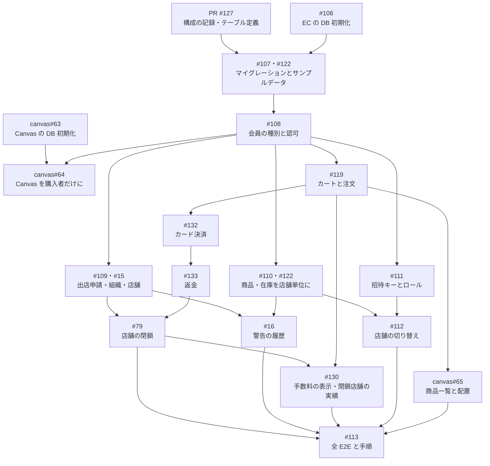

# 新しい DB 構成（v3）の実装計画

2026-11-11 作成、2026-11-12 に作り直し。[database-er.md](database-er.md) の構成を、EC と Canvas に実装する順番です。構成を決めた経緯は、[decisions/2026-11-11-shop-organization-db-v3.md](decisions/2026-11-11-shop-organization-db-v3.md) と [decisions/2026-11-12-db-v3-payments-closure-roles.md](decisions/2026-11-12-db-v3-payments-closure-roles.md) にあります。

- 作業は、EC・Canvas それぞれの統合ブランチ `feature/shop-organization` から切ったブランチで行います。統合ブランチは、動く状態になった区切りで main にマージします（2026-11-12 に、DB の初期化スクリプトと、新しい構成で起動して基本の流れが動く所までを main にマージ。[記録](decisions/2026-11-12-db-v3-application.md)）
- 既存のデータは移行しません。開発用・E2E 用の DB は、初期化スクリプト（#106、abeouga/kusakari-canvas#63）で作り直します
- 起動時に DB を消す処理は作りません。初期化は、確認の入力が付いた手動のスクリプトだけが行います
- 決済は Stripe のテストモードだけを使います。実際のお金は動かしません

## 1. 今の状態（2026-11-12）

| 項目 | 状態 |
| --- | --- |
| 構成の決定 | 済み（#126）。2026-11-12 までの決定（#105・#125・#130・#79・#109・#16・#131）を反映済み |
| EC のテーブル定義 | [database-v3-check/schema.sql](database-v3-check/schema.sql)。使い捨ての MySQL 8.0.46 で27テーブルとイベント1つを作り、制約を160件確かめた |
| EC のマイグレーション | まだない（段階2） |
| Canvas の DB の変更 | 未確認 |
| アプリケーションからの動作、Stripe の API | 未確認（確かめたのは SQL だけ） |

## 2. 先に決めること

実装の前、または実装と並行して決めます。決まるまでは「仮の形」で進め、決まったらテーブル定義・ER 図・マイグレーションを直します（main に入れる前なので、直してよい）。

| 決めること | 仮の形 | 決める場所 | 待っている作業 |
| --- | --- | --- | --- |
| 決済と返金のルール14項目（請求を確定する時点、在庫を確保する時点と時間切れの長さ、状態の名前、返金する場面、受け取り後の返品、返金を実行できる人など。範囲に入れることと Stripe を使うことは決定済み） | #131 の採用候補（Stripe、カードだけ、注文時に請求を確定、お会計1回で決済1つ、注文時に在庫を確保） | #131 | 段階5（#132、#133） |
| 手数料の列の正式な名前、キャンセルされた注文の手数料、率を変える手段、運営が注文実績を開く場所、営業中の店舗の実績を見られる人 | 列は `commission_rate_bp`・`commission_yen`。率は設定値 | #130 | 段階6（#130） |
| 組織の受付停止の列の名前と形 | `suspension_started_at` と `suspended` | #104 | 段階2（#107） |
| 発送を行わないと決めて閉じるか | 発送の列は持たない | #120 | なし（閉じるだけ） |
| 出店規約に同意した記録を DB に持つか | 持たない | #15 | 段階4（#109） |
| 認証基盤に残ったユーザーを、初期化のときに消すか | 消さない前提で、初回ログインの処理を作る | #108 | 段階3（#108） |
| `material_products` を残すか | 残す | #119 | 段階4（#119） |

## 3. 進める順番

各段階は、前の段階が終わってから着手します。同じ段階の中は並行して進められます。

### 段階1：記録と初期化の手段（アプリケーションのコードと DB は変えない）

| 作業 | 内容 | 対応する issue |
| --- | --- | --- |
| 1-1 | 構成を決め、決定の記録・ER 図・テーブル定義・制約の試験を `docs/` に書く | #126、#104（PR #127） |
| 1-2 | EC の DB を初期化するスクリプト | #106 |
| 1-3 | Canvas の DB を初期化するスクリプト。Canvas の統合ブランチを作るところから | abeouga/kusakari-canvas#63 |

### 段階2：テーブルを作る

| 作業 | 内容 | 対応する issue |
| --- | --- | --- |
| 2-1 | EC の Flyway（V1〜V15）を、テーブル定義とサンプルデータにまとめ直す。テーブル定義は `database-v3-check/schema.sql`（27テーブルとイベント1つ）から作る | #107、#122 |
| 2-2 | サンプルデータ：サンプルの組織1つ（オーナーなし）、公開済みで位置のある店舗、店舗ごとの商品（4件以上）、商品ごとの在庫1行、カテゴリー | #107 |
| 2-3 | セットアップの確認（`scripts/setup.ps1`）と、会員を扱うスクリプトを新しい構成に合わせる（マイグレーションの件数、商品4件以上、会員のテーブル名と列） | #107 |
| 2-4 | 制約の試験（`database-v3-check/`）を、マイグレーションで作った DB に対して実行し直す | #107 |
| 2-5 | Canvas の Alembic を1本にまとめ直し、庭の持ち主の列を EC の会員 ID に合わせる | abeouga/kusakari-canvas#63、abeouga/kusakari-canvas#64 |

### 段階3：会員と認可

| 作業 | 内容 | 対応する issue |
| --- | --- | --- |
| 3-1 | 会員のテーブル名と種別（5種類）に合わせて、会員の読み書きとセッションを直す | #108 |
| 3-2 | 認可を3段階に置き換える。オーナーは組織の全店舗、`ORG_ADMIN` は人事の操作、子アカウントは担当店舗を店舗のロールで。ロール未割り当ては、所属した店舗の店舗情報と商品・在庫を見るだけ | #108、#105 |
| 3-3 | 「ロールとできることの対応表」を1か所に作る。ロールを足すときに、対応表を直すだけで済むようにする | #108、#130 |
| 3-4 | 登録した時点で会員を作る（企業様向けの登録、招待キーでの登録） | #108 |
| 3-5 | Canvas を、購入者だけが使えるようにし、庭の持ち主の列の名前に合わせる | abeouga/kusakari-canvas#64 |

### 段階4：機能ごとの置き換え（並行して進められる）

| 作業 | 内容 | 対応する issue |
| --- | --- | --- |
| 4-1 | 出店申請（下書き・審査中・承認・却下・取り下げ・再申請で前回の申請を残す）、承認での組織の作成、オーナーによる店舗の作成と公開。出店規約への同意のチェックと、却下理由の定型文 | #109、#15 |
| 4-2 | 運営による組織の停止（受付停止中 → 停止 → 再開）と、店舗の停止 | #109 |
| 4-3 | 商品と在庫を店舗単位にする。商品の店舗を変更できなくする。公開の判定を1か所の処理にまとめる（`database-er.md` の4章） | #110、#122 |
| 4-4 | 招待キーの発行（1回限り・期限内なら何回でも、有効期限30日）、使用、取り消し、発行済みのキーと使った人の一覧、ロールの割り振り | #111 |
| 4-5 | カートから店舗をなくし、受取店舗を商品から求める。発送の項目と送料をなくす。受取連絡先と支払方法を注文に持つ | #119 |
| 4-6 | 店舗宛ての通知を、その店舗の担当者に送る | #110 |

### 段階5：決済と返金（Stripe のテストモード）

| 作業 | 内容 | 対応する issue |
| --- | --- | --- |
| 5-1 | #131 の「決めること」を決め、範囲の記述（AGENTS.md、`docs/`）を直す | #131 |
| 5-2 | お会計で決済を1つ作り、支払いが成功した通知を受けたときだけ注文を確定する。支払われなかった注文を取り消して在庫を戻す | #132 |
| 5-3 | キャンセルの承認で、その注文の金額だけを返金する。返金の処理は1つのサービスにまとめ、店舗の閉鎖からも呼ぶ | #133 |

### 段階6：運営の操作と、手数料

| 作業 | 内容 | 対応する issue |
| --- | --- | --- |
| 6-1 | 店舗の閉鎖（閉鎖中 → 閉鎖済み）、運営によるまとめてのキャンセルと返金、閉店ページ、90日後の連絡先の削除 | #79 |
| 6-2 | 運営による警告・警告解除と、停止・再開の履歴 | #16 |
| 6-3 | 注文に手数料を保存し、出店者と運営の注文実績に表示する。閉鎖した店舗の注文実績を、オーナー・`ORG_ADMIN`・運営が見られるようにする | #130 |

### 段階7：画面と Canvas

| 作業 | 内容 | 対応する issue |
| --- | --- | --- |
| 7-1 | 出店者画面のヘッダーに店舗の切り替えを置き、選んでいる店舗の商品だけを扱う | #112 |
| 7-2 | Canvas の商品一覧・AI の候補を全店舗の商品から取り、買えなくなった商品（停止・閉鎖）の配置を整理する | abeouga/kusakari-canvas#65 |

### 段階8：まとめての確認

| 作業 | 内容 | 対応する issue |
| --- | --- | --- |
| 8-1 | 統合ブランチで EC と Canvas の全 E2E を通す | #113 |
| 8-2 | 他の PC で DB を初期化してセットアップし直す手順を整える。Stripe のテスト用の鍵と、通知をローカルに転送する道具の用意も手順に入れる | #113 |

## 4. この計画と関係なく進められるもの

統合ブランチではなく main に入れる、小さい修正です。新しい DB の構成を待ちません。

| issue | 内容 |
| --- | --- |
| #128 | カテゴリ名が全角スペースだけでも保存される不具合 |
| #101 | 出店者の検索欄がアイコンに重なる |
| #97 | 通知のベルに未読の数を出す |
| #99 | セッション切れのときのログイン画面の見た目 |
| abeouga/kusakari-canvas#57 | 写真タブの「AI生成」を「完成イメージ」にする |

## 5. 確かめ方

- 段階2：マイグレーションで作った DB に、制約の試験を実行し直す。実際のテーブルが ER 図と一致していることを確かめる
- 段階3以降：実 API と MySQL を使う Chromium E2E で、各 issue の完了条件を確かめる。正常系で API をモックしない
- 段階5：Stripe のテストモードとテスト用のカード番号を使う。通知は、Stripe の道具でローカルに転送する。署名が不正な通知と、同じ通知の2回目も確かめる
- 開発中は、型確認・lint・ビルド・変更した範囲の E2E を実行する。全 E2E は段階8で実行する
- 試験は専用の DB で行い、開発者の DB では行わない

## 6. リスク

| リスク | 起きること | 備え |
| --- | --- | --- |
| 初期化の対象を間違える | 別のプロジェクトや開発者のデータが消える | 対象を特定できない・複数あるときは何も消さずに止める。消す前に対象を表示し、確認の入力を求める（#106、abeouga/kusakari-canvas#63） |
| 初期化で失われるもの | EC：今の会員・店舗・商品・注文。Canvas：庭・写真・画像生成の履歴 | 移行しないと決まっている（#102 決定事項2）。初期化の前に、必要ならバックアップを取る |
| EC と Canvas の片方だけを初期化する | 庭の持ち主と、EC の買い物リストが持つ庭 ID が食い違う | 2つの初期化を続けて実行する手順にする（#113） |
| 決済のルールが後から決まる | 決済と返金のテーブル名・状態の名前・列が変わり、マイグレーションを直すことになる | 段階5の前に #131 を決める。main に入れる前は、マイグレーションを直して DB を作り直す |
| 本番の鍵を使ってしまう | 実際のお金が動く | テスト用の鍵（`sk_test_`・`pk_test_`）だけを受け付け、それ以外の鍵では起動しない確認を入れる（#132 で決める） |
| 通知が届かない・遅れる | 支払ったのに注文が確定しない、返金の結果が反映されない | 支払い待ちの注文を一定時間で取り消す処理と、Stripe に状態を問い合わせ直す手段を #132・#133 で決める |
| 同時実行を確かめていない | 同じ在庫の同時購入、同じ招待キーの同時使用（上限回数を超える）、同じ注文への同時の返金で、想定外の結果になる | 在庫・招待キー・注文の行をロックしてから更新する。二重の決済と返金は、一意キーでも止まる。段階4〜5の E2E で確かめる |
| 連絡先を消すイベントが動かない | 閉鎖から90日たっても、店舗の連絡先が残る | `event_scheduler` が `ON` であることをセットアップで確かめる。失敗の確かめ方を #79 で決める |
| 途中の段階では画面が動かない | 段階2の後、段階3〜4が終わるまで、統合ブランチで一部の画面が動かない | 統合ブランチの中だけで進め、main には入れない |

## 7. この計画に含めないもの

- 本番の決済（実際にお金を動かすこと）、加盟店の審査、手数料の請求・精算、Stripe Connect
- 発送（#120）、別の店舗の商品の複製（#121。保留のまま閉じた）、ポイント・クーポン・前払いの残高
- 外部へのメール配信（領収書のメールを含む）
- 統合ブランチを main に入れる時期と方法（#113 で決める）
