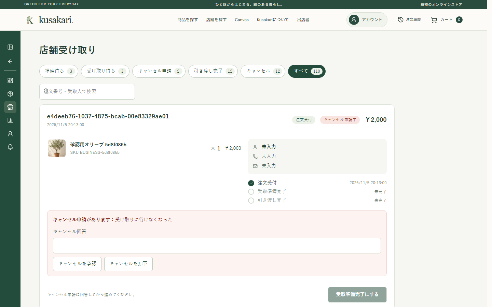

# PR用スクリーンショットを専用ブランチに置く

## Context

- フロントを変更するPRには、変更後の画面のスクリーンショットを本文に付ける。
- `gh pr create` などのCLIでは、PR本文に画像を直接添付できない。ブラウザで画像をドラッグ＆ドロップする方法は手作業になり、エージェントによる自動作成に向かない。
- スクリーンショットを作業ブランチに含めると、PRをマージしたときに画像がmainへ入る。画像はPRを確認するための資料で、アプリの成果物ではない。mainに残すとリポジトリが重くなり、画面を変えるたびに古い画像が残る。
- E2Eの成果物を置く `artifacts/` は `.gitignore` の対象なので、そのままではpushできない。

## Decision

- スクリーンショットは、mainと履歴を共有しない専用ブランチ `pr-screenshots`（orphanブランチ）に置く。このブランチはmainへマージしない。
- 画像はPRのブランチ名ごとのディレクトリに置く。ディレクトリ名は、ブランチ名の `/` を `-` に置き換えたものにする（例: `improve/43-44-seller-nav` → `improve-43-44-seller-nav/`）。
- PR本文では、rawのURLで画像を埋め込む。リポジトリがpublicなので、ログインしていなくても表示される。

  ```markdown
  
  ```

- スクリーンショットはE2E（実Cognito・実API・`kusakari_e2e`）の中で撮る。幅は1440pxと390pxの2種類にし、PR本文では表に並べる。
- 撮った画像は、pushする前に必ず開いて確認する。メールアドレス、トークン、実利用者のデータが写っていないことを確かめる。

## 手順

### 初回だけ: 専用ブランチを用意する

```bash
git fetch origin
git worktree add --detach ../kusakari-ec-shots
cd ../kusakari-ec-shots
git switch --orphan pr-screenshots
# README.md に「PR本文に埋め込むスクリーンショット置き場。mainにはマージしない。」と書く
git add README.md
git commit -m "PR用スクリーンショット置き場を作る"
git push -u origin pr-screenshots
```

`origin/pr-screenshots` がすでにある場合は、次のようにチェックアウトするだけにする。

```bash
git worktree add ../kusakari-ec-shots pr-screenshots
```

`git switch --orphan` で作ったブランチは、空の状態から始まる。mainのファイルや履歴は含まれない。worktreeにしておくと、作業中のブランチを切り替えずに画像を追加できる。

### PRごと: 撮影して公開する

1. E2Eの中でスクリーンショットを撮る。`e2e/business-helpers.js` の `capture()`（PR #54で追加）を使うと、読み込み表示が消えるまで待ち、`@` を含む文字（メールアドレス）を隠して撮影できる。

   ```js
   await page.setViewportSize({ width: 390, height: 844 });
   await capture(page, 'artifacts/business/sidebar/sidebar-seller-closed-390.png');
   ```

2. 撮った画像を開いて、個人情報や秘密情報が写っていないことを確認する。
3. 専用ブランチに画像をコピーし、pushする。

   ```bash
   cd ../kusakari-ec-shots
   git pull --rebase
   mkdir -p improve-43-44-seller-nav
   cp ../kusakari-ec-43-44/artifacts/business/sidebar/*.png improve-43-44-seller-nav/
   git add improve-43-44-seller-nav
   git commit -m "improve: #43 #44 のPR用スクリーンショットを追加する"
   git push
   ```

4. PR本文に `https://raw.githubusercontent.com/abeouga/kusakari-ec/pr-screenshots/<ディレクトリ>/<ファイル>.png` で埋め込む。PRを作った後で画像を差し替えた場合は、同じファイル名で上書きしてpushする。画像はキャッシュされるため、表示が切り替わるまで数分かかることがある。

## Alternatives

- **作業ブランチに画像をcommitする**: PRと一緒にmainへ入るため採用しない。
- **ブラウザでPRに画像をドラッグ＆ドロップする**: GitHubのサーバーに画像が置かれ、リポジトリは汚れない。しかし手作業が必要で、CLIやエージェントでは自動化できないため採用しない。手で撮った画像を数枚付けるだけなら、この方法でもよい。
- **GitHub Releasesの添付ファイルや外部の画像ホスティングを使う**: リリースの意味が変わる、または外部サービスへのアップロードとアカウントが増えるため採用しない。
- **画像をGitHub Actionsのartifactにする**: ダウンロードしないと見られず、保存期限もあり、PR本文に埋め込めないため採用しない。

## Consequences

- mainには画像が入らない。PRのブランチを削除しても、本文の画像は表示され続ける。
- `pr-screenshots` ブランチは画像が増えるたびに大きくなる。2026-11-06時点では、PR 5本分（#54〜#58、94枚）で約13MB。大きくなりすぎたら、マージ済みPRのディレクトリを削除する。ただし削除すると、そのPR本文の画像は表示されなくなる。
- リポジトリがpublicなので、画像は誰でも見られる。テスト用データだけが写るようにし、push前の確認を省かない。リポジトリをprivateにした場合、rawのURLは一時トークンなしでは表示できないため、この方法を見直す。
- 複数のエージェントが同時に画像を追加すると、pushが競合することがある。追加する前に `git pull --rebase` を行う。
