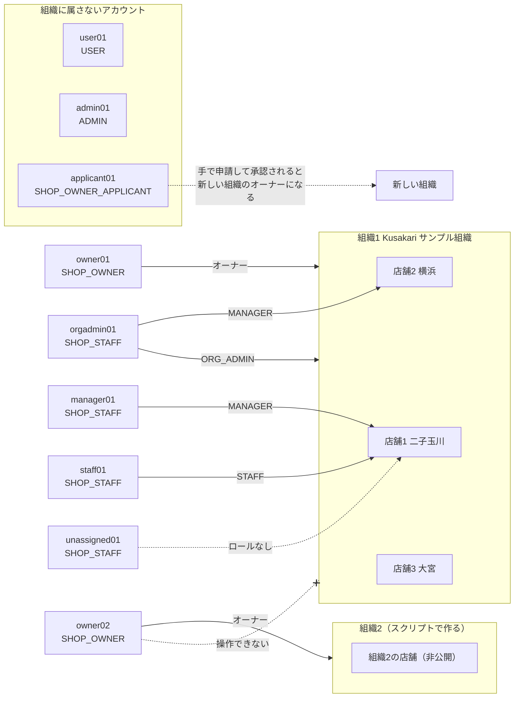
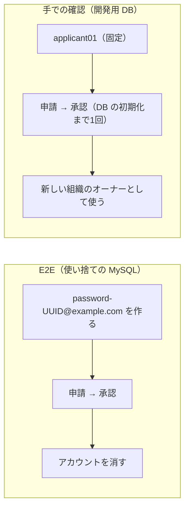
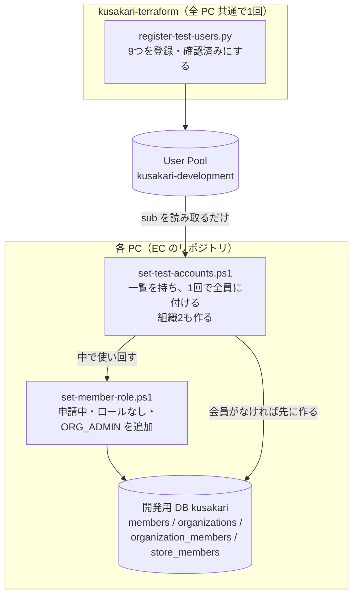
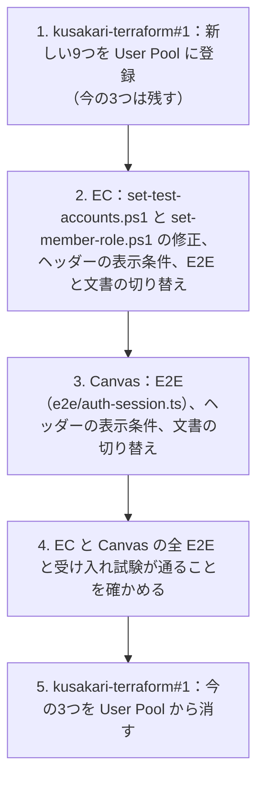

# テスト用アカウントの作り直しと、各 PC の DB への種別の付け方（#156）

## Context

受け入れ試験（`e2e/configs/playwright.acceptance.config.js`）と手での動作確認には、開発用の User Pool（Cognito の `kusakari-development`、全 PC で共通）に登録した固定のテスト用アカウントを使っている。今あるのは `test.user`・`test.seller`・`test.admin`（いずれも `@example.com`）の3つで、次の問題があった。

- 名前からロールが分からない。`test.seller` は店舗1の MANAGER になるなど、名前と付くロールが合っていない。
- DB 構成 v3（[記録](2026-11-11-shop-organization-db-v3.md)）で店舗側のアカウントがオーナーと担当者（MANAGER・STAFF・ロールなし、組織の ORG_ADMIN）に分かれ、3つでは足りない。オーナー・STAFF・ロールなし・ORG_ADMIN・申請中と、別の組織との境界を確かめられない。
- 開発用 DB は PC ごとにあり、`DB-reset.bat` で初期化すると会員が0件になる。Cognito のユーザーは残るので、初めてログインすると全員が購入者（`USER`）になる（#108）。PC ごとに種別を付け直す必要がある。
- `scripts/set-member-role.ps1` は運営・オーナー・担当者（MANAGER か STAFF）しか付けられず、ログイン済みの会員1件ずつしか変えられない。
- User Pool に登録するスクリプト（kusakari-terraform の `scripts/register-test-users.py`）は v3 の前のテーブル（`auth_members`）に書き込む作りで、今の DB では動かない（abeouga/kusakari-terraform#1）。
- EC（`frontend/src/App.jsx`）と Canvas（`frontend/src/components/SiteHeader.jsx`）のヘッダーは、運営画面へのリンクを「メールが `test.admin@example.com` で、種別が `ADMIN`」のときだけ出している。アカウントの名前を変えると、運営のアカウントでもリンクが出なくなる。

2026-11-15 に、ユーザーが下の案で決めた（購入者の名前は `buyer01` ではなく `user01`、組織2はスクリプトで作る）。

## Decision

### 1. 用意するアカウント（9つ）

メールアドレスはすべて `@example.com`。example.com はメールを受け取れないので、User Pool には管理者の API で確認済みとして登録する。同じロールで2つ目が要るときは番号を増やす（02、03…）。

| アカウント | 表示名 | 種別とロール | 確かめること |
| --- | --- | --- | --- |
| user01 | テスト購入者01 | 購入者（`USER`） | カート・注文・Canvas |
| admin01 | テスト運営01 | 運営（`ADMIN`） | 申請の審査、組織・店舗・商品の管理 |
| owner01 | テストオーナー01 | サンプル組織（組織1）のオーナー（`SHOP_OWNER`） | 店舗の作成と閉鎖、ORG_ADMIN の付け外し、組織の全員の一覧 |
| orgadmin01 | テストORG_ADMIN01 | 組織1の ORG_ADMIN（`SHOP_STAFF`）、店舗2の MANAGER | 組織の全店舗のロールの割り振り。商品は担当の店舗だけ |
| manager01 | テストMANAGER01 | 店舗1の MANAGER（`SHOP_STAFF`） | 店舗情報、商品の登録と削除、キャンセルへの回答、招待キー |
| staff01 | テストSTAFF01 | 店舗1の STAFF（`SHOP_STAFF`） | 商品の編集・在庫・受け渡しができ、登録と削除はできない |
| unassigned01 | テストロールなし01 | 店舗1の担当でロールなし（`SHOP_STAFF`） | 店舗情報と商品を見るだけ |
| applicant01 | テスト申請者01 | 申請中（`SHOP_OWNER_APPLICANT`） | 出店の申請と、承認されて新しい組織のオーナーになる流れ（手での確認） |
| owner02 | テストオーナー02 | 組織2のオーナー（`SHOP_OWNER`） | 別の組織の店舗・担当者・商品を操作できないこと |

パスワードは全員共通で、Git に入らない kusakari-terraform の `.env.test-accounts`（`KUSAKARI_TEST_PASSWORD`）に置く。

### 2. 申請中のアカウント

- E2E は、今までどおり確かめるたびに使い捨てのアカウント（`createPasswordTestAccount` の `password-<UUID>@example.com`）を作って消す。何度でも確かめられる。
- 手での確認は、固定の `applicant01` を使う。申請の流れは DB を初期化するまで1回だけ確かめられる。承認された後は、新しい組織のオーナーとしてそのまま使う。別の組織との境界の確認には使わない（名前とロールが合わなくなるため。境界は `owner02` で確かめる）。
- 種別を付けるスクリプト（下の 4）は、`applicant01` が購入者のときだけ申請中にする。すでに申請中・承認済み（`SHOP_OWNER`）なら変えない。

### 3. 別の組織との境界

`owner02` を固定で用意し、組織2は各 PC で種別を付けるスクリプトが作る。サンプルデータ（`V2__sample_data.sql`）には足さない。

- 組織2は「Kusakari テスト組織2」、店舗は1つ（「テスト組織2の店舗」）で、非公開（`published = FALSE`）にする。購入者の商品一覧や Canvas の商品の候補に出さないため。
- スクリプトは、`owner02` がオーナーの組織がなければ、組織と店舗を1つのトランザクションで作る。あれば何もしない（何度実行しても組織は増えない）。

### 4. 各 PC の開発用 DB への種別の付け方

EC のリポジトリに、テスト用アカウントの一覧を持つスクリプト（`scripts/set-test-accounts.ps1`）を作り、各 PC で1回実行すれば全員の種別がそろうようにする。kusakari-terraform の登録のスクリプトは User Pool への登録と削除だけを行い、EC の DB には書き込まない。

- 会員がまだない（そのアカウントでまだログインしていない）ときは、スクリプトが User Pool から ID（`sub`）を読み取り（`aws cognito-idp admin-get-user`、プロファイル `kusakari-dev`）、会員（`members`、メール確認済み）を先に作る。AWS の読み取り権限がない PC では、まだログインしていないアカウントを飛ばして一覧で知らせる（一度ログインしてから再実行すればそろう）。
- 種別とロールの付け方は `scripts/set-member-role.ps1` を中で使い回す。`set-member-role.ps1` は、申請中（`-Role SHOP_OWNER_APPLICANT`）、ロールなし（`-StoreRole NONE`）、ORG_ADMIN（`-OrganizationAdmin`）を付けられるように直す。今の使い方（引数）は変えない。
- 今と同じく、すでに別のオーナーがいる組織、別の組織の担当者、店舗側のアカウントから運営への変更は、変えずに止める。対象は開発用 DB（`kusakari`）だけで、E2E 用 DB（`kusakari_e2e`）は E2E が試験ごとに準備する。

### 5. 運営画面へのリンクの表示条件

EC と Canvas のヘッダーは、メールアドレスを見ずに、種別が `ADMIN` かどうかだけで運営画面へのリンクを出す。種別の正本は EC の DB で（[会員の種別とロールの値](../member-roles.md)）、特定のメールアドレスに縛る理由がないため。運営画面の API は、今までどおりサーバー側で `ADMIN` を確かめる。

### 6. E2E の切り替えの範囲と順番

今のアカウントは次のように置き換える。E2E 用 DB で試験ごとに種別を付け替える作り（`e2e/business-helpers.js` の `prepareMember`）は残す。

| 今のアカウント | 新しいアカウント |
| --- | --- |
| test.user@example.com | user01@example.com |
| test.seller@example.com | manager01@example.com |
| test.admin@example.com | admin01@example.com |

今の3つを消すのは、EC と Canvas の E2E を切り替えて通した後にする。先に消すと、EC の E2E（51ファイル）と Canvas の E2E が動かなくなる。今のアカウントを書いているのは、EC が57ファイル（E2E の51ファイル、文書4つ、`frontend/src/App.jsx`、`packages/site-header/README.md`）、Canvas が5ファイル（`e2e/auth-session.ts`、`frontend/src/components/SiteHeader.jsx`、`README.md`、文書2つ）。

## Alternatives

- 購入者を `buyer01` にする：ユーザーの指定で、種別の値（`USER`）に合わせて `user01` にした。
- 申請中を固定の `applicant01` だけにする：申請の流れを E2E で何度も確かめられないため、E2E は使い捨てのままにする。
- 申請中を使い捨てだけにする：手で確かめるたびにスクリプトを実行する必要があるため、手での確認用に `applicant01` も置く。
- 承認された `applicant01` を境界の確認に使う：名前とロールが合わなくなり、この作り直しの目的に反するため。
- 境界を E2E の使い捨てだけで確かめる：手での確認ができないため、`owner02` を固定で置く。
- 組織2をサンプルデータ（`V2__sample_data.sql`）に足す：main に入った V2 を書き換えると全 PC で DB の作り直しが要り、マイグレーション（V4）で足すと本番相当のデータにテスト用の組織が入るため。
- `set-member-role.ps1` を直して1つずつ実行する：9つを PC ごとに手で実行するのは手間で、付け方が PC ごとにずれやすいため、一覧を持つスクリプトにした（中では使い回す）。
- kusakari-terraform の登録のスクリプトが DB の種別まで付ける（v3 の前の作りと同じ）：Cognito を扱うリポジトリが各 PC の EC の DB の構成に依存し、v3 の前のように DB の変更で動かなくなるため。
- 9つすべてで一度ログインしてからスクリプトを実行する：PC ごとに9回ログインが要るため、AWS の読み取り権限がある PC では `sub` を読み取って会員を先に作る。権限がない PC だけ、この方法になる。
- 運営画面へのリンクの条件を `admin01@example.com` に書き換える：アカウントを作り直すたびに画面のコードを直すことになるため。

## Consequences

- 各 PC の作業：DB を初期化した後に `scripts/set-test-accounts.ps1` を1回実行すれば、9つの種別と組織2がそろう。AWS の読み取り権限がない PC では、まだログインしていないアカウントで一度ログインしてから再実行する。
- 組織2と店舗は、各 PC の開発用 DB にだけ作られる。E2E 用 DB とサンプルデータには入らない。
- `applicant01` の申請は DB を初期化するまで1回だけ確かめられる。2回目以降は E2E か、DB の初期化が要る。
- 運営画面へのリンクは、種別が `ADMIN` のアカウントならどのメールアドレスでも出るようになる。
- 今の `test.user`・`test.seller`・`test.admin` は、切り替えの後に User Pool から消す。消した後に古いブランチの E2E を実行すると、ログインで失敗する。
- 実装の issue：EC は #157（スクリプト・ヘッダー・E2E・文書）、Canvas は abeouga/kusakari-canvas#76（E2E・ヘッダー・文書）、User Pool は abeouga/kusakari-terraform#1（登録のスクリプトと、登録・削除）。
