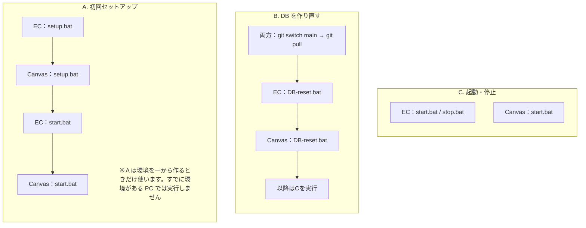
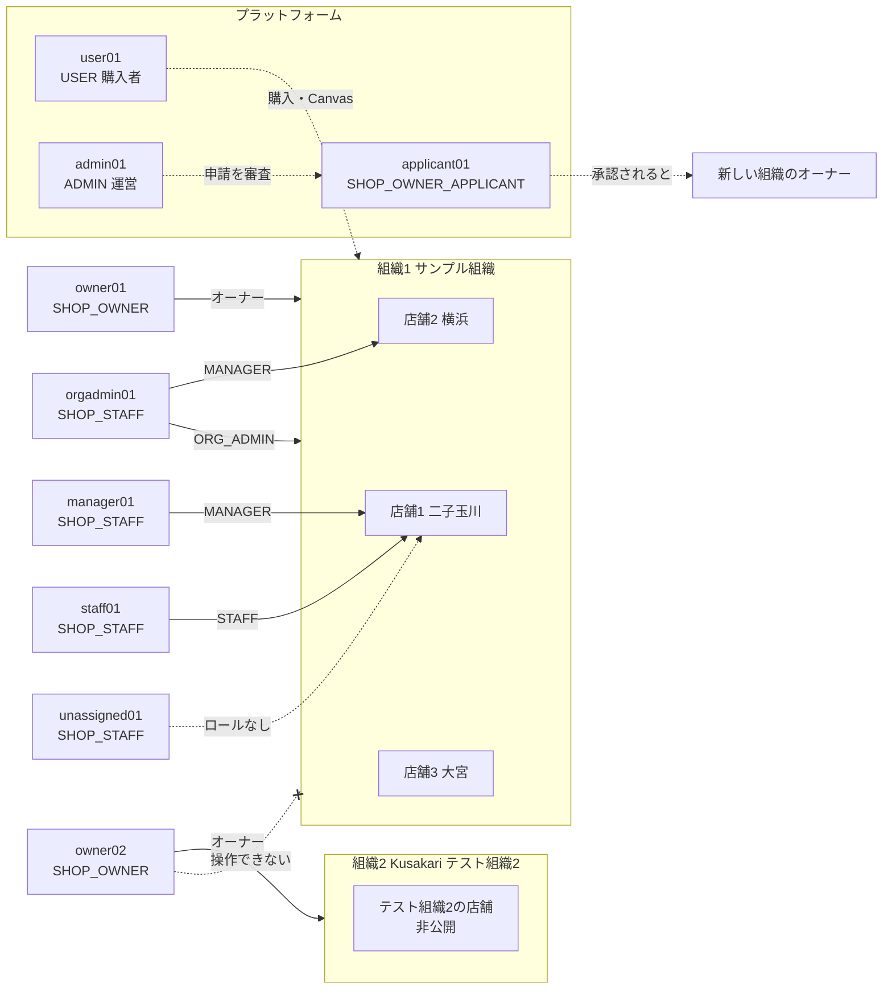

# ほかの PC で実行するスクリプトと実行順

## 1. 実行順の全体図

## 2. スクリプトの一覧

### EC（kusakari-ec）

| スクリプト | いつ | すること |
| --- | --- | --- |
| `setup.bat` | A で使います。 接続設定を作り直すときは `setup.bat -Reconfigure` | MySQL（3306 の既存のもの、なければ専用の MySQL を 3307 に用意）・接続設定（`.env`）・依存・ビルドを準備し、開発用と E2E 用の DB のテーブルを作って確かめる。最後にテスト用アカウント9つをそろえる。データは消さない |
| `start.bat` | C で使います | Web・API・ブラウザー・SysOverRay の操作画面を起動する |
| `stop.bat` | C で使います | API と Web を止める |
| `DB-reset.bat` | B で使います | Web と API を止め、`npm install` と API のビルドをしてから、`kusakari` と `kusakari_e2e` を削除して作り直す |
| `scripts\set-test-accounts.ps1` | A・B の `setup.bat` と `DB-reset.bat` が実行するので、単体では使いません | 開発用 DB に、テスト用アカウント9つの会員・種別・ロールと、テスト組織2を入れる |
| `scripts\set-member-role.ps1` | 通常は使いません | 一度ログインした会員1件の種別とロールを変える（[会員の種別とロールの値](member-roles.md)） |
| `MySQL-reset.bat` | MySQL の root のパスワードが分からず A が進まないときに使います | 管理者として MySQL のサービスを止め、root のパスワードを設定し直す |

### Canvas（kusakari-canvas）

| スクリプト | いつ | すること |
| --- | --- | --- |
| `setup.bat` | A | Node.js・uv・Python・依存・MySQL（なければ専用の MySQL）・GLB を準備する。データは消さない |
| `start.bat` | C | API（8080）と Web（5173）を起動する |
| `DB-reset.bat` | B | このフォルダーの `start.bat` で起動した Canvas を止め、Python の依存をロックファイルに合わせてから、確認なしで `kusakari_canvas` と `kusakari_canvas_e2e` だけを消して作り直す。ほかのプロセスの接続は切る |

## 3. 登録されているアカウント一覧

| アカウント | 種別とロール |
| --- | --- |
| user01@example.com | 購入者 |
| admin01@example.com | 運営 |
| owner01@example.com | サンプルの組織（店舗1〜3）のオーナー |
| orgadmin01@example.com | サンプルの組織の ORG_ADMIN、店舗2の MANAGER |
| manager01@example.com | 店舗1の MANAGER |
| staff01@example.com | 店舗1の STAFF |
| unassigned01@example.com | 店舗1の担当でロールなし |
| applicant01@example.com | 申請中（出店の申請を1回だけ試せる） |
| owner02@example.com | テスト組織2（非公開の店舗1つ）のオーナー |

**テスト用アカウント9つは、何もしなくてもそろいます。** EC の `setup.bat` と `DB-reset.bat`（どちらか片方でよい）が最後に `scripts/set-test-accounts.ps1` を実行し、開発用 DB に会員と種別を入れます。そのまま `user01@example.com` などでログインできます。

### 関係図

