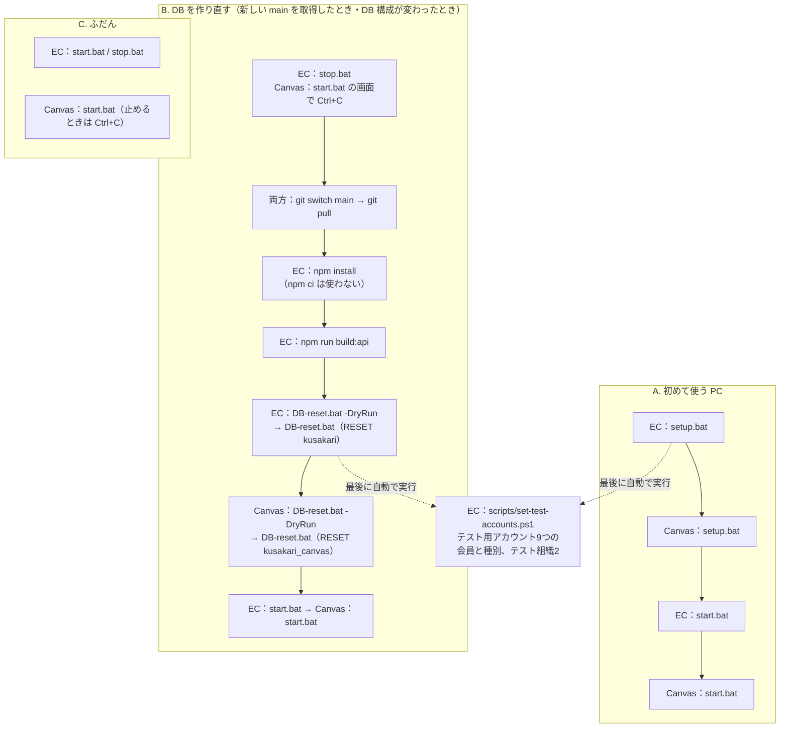

# ほかの PC で実行するスクリプトと実行順

EC（kusakari-ec）と Canvas（kusakari-canvas）を、ほかの PC で使える状態にするために実行するスクリプトを、すべてここにまとめる。
どのスクリプトも、それぞれのリポジトリのフォルダーで実行する。AWS の環境は要らない。

## 1. 実行順の全体図

- **A は1回だけ**行う。B は、新しい main を取得して DB の構成が変わったときや、DB を最初の状態に戻したいときに行う。C は毎日の起動と停止。
- **EC を先に、Canvas を後に**行う。Canvas は、ログインと商品を EC に問い合わせる。
- **DB の作り直しは、EC と Canvas の両方で行う。** EC だけを作り直すと、庭の持ち主（EC の会員）と買い物リストの庭が食い違う。
- **テスト用アカウント9つは、何もしなくてもそろう。** EC の `setup.bat` と `DB-reset.bat` が最後に `scripts/set-test-accounts.ps1` を実行し、開発用 DB に会員と種別を入れる。そのまま `user01@example.com` などでログインできる。

## 2. スクリプトの一覧

### EC（kusakari-ec）

| スクリプト | いつ | すること |
| --- | --- | --- |
| `setup.bat` | 初めて使うとき。接続設定を作り直すときは `setup.bat -Reconfigure` | MySQL（3306 の既存のもの、なければ専用の MySQL を 3307 に用意）・接続設定（`.env`）・依存・ビルドを準備し、開発用と E2E 用の DB のテーブルを作って確かめる。最後にテスト用アカウント9つをそろえる。データは消さない |
| `start.bat` | 毎日の起動 | API（8086）と Web（5186）を起動し、ブラウザーと操作画面を開く |
| `stop.bat` | 毎日の停止 | このフォルダーから起動した API と Web だけを止める |
| `DB-reset.bat` | DB を作り直すとき。先に `-DryRun` で対象を確かめる | 管理者として起動し直し、`kusakari` と `kusakari_e2e` だけを消して作り直す。消す前にバックアップを取り、確認の文字（`RESET kusakari`）の入力を求める。最後にテスト用アカウント9つをそろえる |
| `scripts\set-test-accounts.ps1` | ふつうは実行しない（`setup.bat` と `DB-reset.bat` が実行する）。DB を作り直さずにテスト用アカウントをそろえ直したいときだけ | 開発用 DB に、テスト用アカウント9つの会員・種別・ロールと、テスト組織2を入れる。何度実行しても同じ結果になる。AWS にもネットにも接続しない |
| `scripts\set-member-role.ps1` | テスト用アカウント以外の会員を、開発用に運営や店舗側にしたいとき | 一度ログインした会員1件の種別とロールを変える（[会員の種別とロールの値](member-roles.md)） |
| `MySQL-reset.bat` | 困ったときだけ。MySQL の root のパスワードが分からず `setup.bat` が進まないとき | 管理者として MySQL のサービスを止め、root のパスワードを設定し直す |

### Canvas（kusakari-canvas）

| スクリプト | いつ | すること |
| --- | --- | --- |
| `setup.bat` | 初めて使うとき | Node.js・uv・Python・依存・MySQL（なければ専用の MySQL）・GLB を準備する。データは消さない |
| `start.bat` | 毎日の起動。止めるときはその画面で Ctrl+C（`Terminate batch job (Y/N)?` には `N`） | API（8080）と Web（5173）を起動する |
| `DB-reset.bat` | EC の `DB-reset.bat` の後。先に `-DryRun` で対象を確かめる | 管理者として起動し直し、Canvas の `kusakari_canvas` と `kusakari_canvas_e2e` だけを消して作り直す。確認の文字は `RESET kusakari_canvas` |

## 3. 手順

### A. 初めて使う PC

1. EC と Canvas を同じフォルダーに並べて clone する（`kusakari-ec` と `kusakari-canvas`）
2. EC のフォルダーで `setup.bat` を実行する
3. Canvas のフォルダーで `setup.bat` を実行する
4. EC の `start.bat`、続けて Canvas の `start.bat` で起動する
5. ブラウザーで EC（http://127.0.0.1:5186）を開き、テスト用アカウントでログインする

### B. DB を作り直す

1. EC の `stop.bat` で止める。Canvas は `start.bat` の画面で Ctrl+C を押して止める
2. 両方のフォルダーで `git switch main` → `git pull` する。自分の変更があるときは、先にコミットするか退避する
3. EC で `npm install` を実行する。**`npm ci` は使わない**（Windows で `frontend` のソースを消したことがある）
4. EC で `npm run build:api` を実行する。作り直しの後の確認は、このフォルダーの API でテーブルを作るため
5. EC で `DB-reset.bat -DryRun` を実行し、表示された MySQL・ポート・DB が自分の PC のものかを確かめる。Windows の確認では「はい」を選ぶ
6. EC で `DB-reset.bat` を実行し、`RESET kusakari` と入力する。「テスト用アカウント9つの会員と種別をそろえました」と「EC の DB の初期化が完了しました」が出るまで待つ
7. Canvas で `DB-reset.bat -DryRun` → `DB-reset.bat` を実行し、`RESET kusakari_canvas` と入力する
8. EC の `start.bat`、続けて Canvas の `start.bat` で起動する
9. テスト用アカウントでログインし、商品一覧・カート・Canvas の庭の一覧が開けることを確かめる

消える DB のデータと、うまくいかないときの対処は [他の PC の移行手順](migration-other-pc.md) と [EC の DB の初期化](database-reset.md) にある。

## 4. テスト用アカウント

| アカウント | 種別とロール |
| --- | --- |
| user01@example.com | 購入者 |
| admin01@example.com | 運営 |
| owner01@example.com | サンプルの組織（店舗1〜3）のオーナー |
| orgadmin01@example.com | サンプルの組織の ORG_ADMIN、店舗2の MANAGER |
| manager01@example.com | 店舗1の MANAGER |
| staff01@example.com | 店舗1の STAFF |
| unassigned01@example.com | 店舗1の担当でロールなし |
| applicant01@example.com | 申請中（出店の申請を1回だけ試せる） |
| owner02@example.com | テスト組織2（非公開の店舗1つ）のオーナー |

- パスワードは9つで共通。管理者から Git 以外の経路で受け取る。スクリプトにはパスワードは要らない。ログインするときだけ使う。
- E2E を実行する PC だけ、受け取ったパスワードを EC と Canvas の隣の `kusakari-terraform\.env.test-accounts` に `KUSAKARI_TEST_PASSWORD=...` の1行で置く（Git に入れない）。
- アカウントの決め方は [テスト用アカウントの作り直し](decisions/2026-11-15-test-accounts.md) にある。
